# Fleet Console Guide

The WhatSoup Fleet Console is a React dashboard for managing all WhatsApp instances from a browser. It runs on the same port as the fleet server in production (`http://localhost:9099`) or via Vite dev proxy during development.

## Console Authentication

In production the console starts **locked**. The served page carries no
credentials — enter the fleet token on the lock screen to start a session:

- The token is sent once to `POST /api/console-session` and never stored in
  the browser; the server answers with an HttpOnly `SameSite=Strict` session
  cookie (24-hour fixed lifetime).
- Authenticated HTTP and SSE requests use short-lived audience tickets minted
  against that session; WebSocket connections use a separate `/api/ws-ticket`.
  A fleet-server restart relocks the console.
- **Lock** closes local access immediately, then requests server revocation with
  `DELETE /api/console-session`. Only a successful response confirms revocation
  and cookie clearing. Failure leaves the screen locked with **Retry lock** and
  an explicit unconfirmed outcome; pending duplicate requests are coalesced.
  The lock screen serializes token unlock and retry handlers so an older unlock
  response cannot overtake a newer revocation request.
  A non-secret session-storage marker preserves an unfinished lock across reload
  in the same tab. It is cleared by confirmed revocation or explicit token unlock.
  If storage cannot be read, the console stays closed. If it cannot save the marker,
  the screen explains, including while revocation is pending, that reload may
  reopen the session until revocation succeeds.
  If the marker cannot be cleared after a confirmed session change, local access
  stays closed with **Retry browser storage**. Recovery clears the marker, then
  checks the current server session without repeating the mutation.
  This local marker does not revoke credentials or replace server authorization.
- An unavailable session check stays closed with **Retry session check**; it is
  distinguished from the server confirming that the session is absent or expired.
  Retired probes and revocation responses cannot overwrite a newer local action.
- The fleet token lives in `~/.config/whatsoup/fleet-tokens.json` on the
  fleet host.
- Dev mode (Vite proxy) bypasses the lock screen — the proxy injects auth
  server-side and the page carries no `fleet-auth-mode` meta tag.

## Connection and update outcomes

Realtime readiness requires the server's `connected` hello. An open socket alone
keeps ordinary polling active. If hello does not arrive within ten seconds, the
console retires that connection and retries with the existing one-to-thirty-second
exponential backoff. The hello deadline bounds each socket's wait; it does not
remove the delay between failed connection attempts.
Callbacks from retired connections cannot change the current connection or its
caches. Existing stream-gap reconciliation runs before readiness; legacy hello
frames remain supported. Line queries retain their slower polling backstop after
readiness.

`GET /api/version` advertises `updateMode: release_deploy`. The update dialog then
links to the [release deployment runbook](runbooks/release-deployment.md) without
issuing an in-place update or restarting instances. Unknown advertised update modes
also withhold those mutations. Servers that omit the field retain the compatibility
flow; the existing `update-by-release-deploy-required` refusal switches that flow
to deployment guidance. A fleet recovery timeout is unconfirmed recovery, not an
update-complete result. Closing or reopening the dialog invalidates pending callbacks.

An instance restart's HTTP202 response confirms a request, not recovered health.
Restart batches prevent duplicate pending requests and do not resubmit an already
accepted item when another item fails. Check instance health after acceptance or an
unconfirmed result. Mode changes persist configuration before requesting restart;
both line views refresh after that write, even when restart cannot be confirmed.

## Pages

The navigation rail groups pages into **Operate**, **Create**, and **System**.
The route definitions live in [App.tsx](../console/src/App.tsx); rail labels and
groups live in [route-meta.ts](../console/src/components/chrome/route-meta.ts).

| Group | Page | Route and current boundary |
|---|---|---|
| Operate | Fleet | `/`: lines, health, KPIs and activity. A line opens `/lines/:name`. |
| Operate | Agents | `/agents`: agent-mode line roster and selected-line details backed by fleet queries. |
| Operate | Inbox | `/inbox`: conversations and replies for the selected line. |
| Operate | Ops | `/ops`: logs and operations; `/ops?tab=metrics` opens metrics. Legacy `/operator` and `/metrics` links redirect here. |
| Create | Skills | `/skills`: searchable plugin catalog. Skill, MCP-server and tool catalog types remain empty; upload and organization-hub actions are disabled. |
| Create | Dream Lab | `/dream-lab`: review layout with an empty queue. A Dream backend and persisted decisions are not implemented. |
| System | Deployments | `/deployments`: the local deployment uses live fleet/version/liveness data. Remote pairing and hub synchronization remain designed states. |
| System | Settings | `/settings`: workspace, channels, notifications, API tokens and danger-zone sections. Disabled controls identify capabilities without a backend. |

`/welcome` and `/hatch` provide the landing and onboarding journey outside those
rail groups. A visible route does not imply that every designed action is implemented.
The screenshots below retain earlier layouts; use the route table and current
components for navigation and capability decisions.

### Fleet

The landing page. Shows fleet-wide KPIs, a connection table for all instances, and a live activity feed.

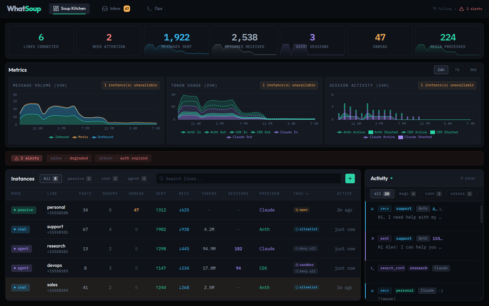

**KPI cards** across the top track: lines connected, lines needing attention, messages sent/received, active agent sessions, unread count, and media processed. Each card is clickable to filter the connection table.

**Alert banner** appears when instances are unhealthy — shows which lines need attention and why (auth expired, degraded, unreachable).

**Connection table** lists every instance with its mode badge, phone number, message counts, session stats, heartbeat strip, and status. Filter by mode (passive, chat, agent) or status (online, degraded, unreachable).

**Activity feed** on the right streams real-time events from all instances — messages, connections, errors, and session lifecycle events. Filter by category: messages, connections, errors, health, sessions.

### Ops (Operations)

Fleet health monitoring with instance management actions.

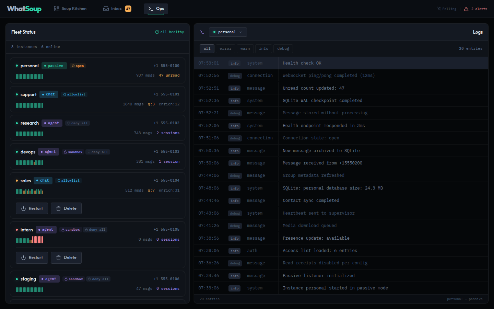

The left panel shows every instance with its status, phone number, message count, and session info. Unhealthy instances display restart and delete buttons inline.

Deletion succeeds only after the service is stopped and disabled and its config,
data and state directories are removed. If cleanup is incomplete, the API returns
`instance_cleanup_failed` with `mutation_state: unknown` and `retryable: false`.
The line detail page shows the recovery message and stays open. Inspect the
remaining directories and the correlated server log, correct the cleanup failure,
then explicitly retry deletion. A failure can leave only part of the instance;
it does not mean that deletion had no effect.

Failed creation reports `rolled_back` with `rollback_state: succeeded` only after
service compensation and filesystem restoration succeed. A rejected enable call
can have changed service state before losing its response, so creation attempts
disable before removing its files. Failed compensation retains the files and
reports `rollback_failed` with `rollback_state: failed`. Inspect service state and
the correlated server log before repair or another creation attempt; the API does
not automatically retry an uncertain service operation.

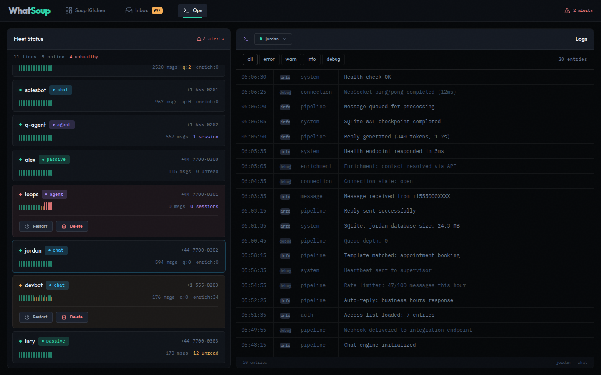

The console tab shows a structured log viewer with level filtering (all, error,
warn, info, debug). Select a line to view its logs. The log viewer shows timestamps,
sources, and severity levels. The Metrics tab contains the fleet charts previously
available at `/metrics`.

### Inbox

Unified message inbox across all instances. Read conversations and send replies
from one view. Channel filters and the Direct/Rooms selector narrow the shared
conversation list; selecting a conversation binds its thread to that line.

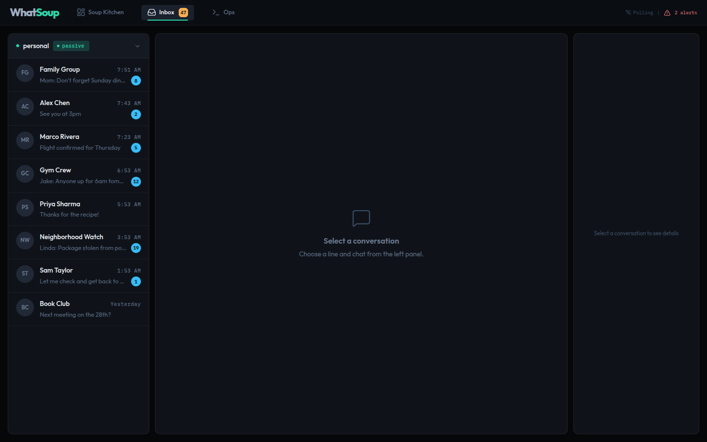

**Chat list** shows matching conversations across lines with contact avatars,
last message previews, timestamps, and unread badges.

**Message view** renders the conversation with bubble-style messages. Outgoing messages appear on the right in the accent color; incoming messages on the left in a neutral tone.

History loading and end-of-history state belong to each conversation. Switching
threads leaves an existing request attached to its original conversation and
allows the new thread to load independently. Overlapping history pages retain
the current cached message once. Returning to a thread preserves its pagination
state until the Inbox is remounted.

**Contact details** panel (right side) shows the contact, line, conversation type,
and recorded agent session. Contact access controls live on the line detail page.

#### Inbox by Mode

The inbox adapts to the selected instance's mode:

**Chat mode** — Shows bot conversations. Bot responses appear as outgoing messages with appointment confirmations, availability listings, and structured replies.

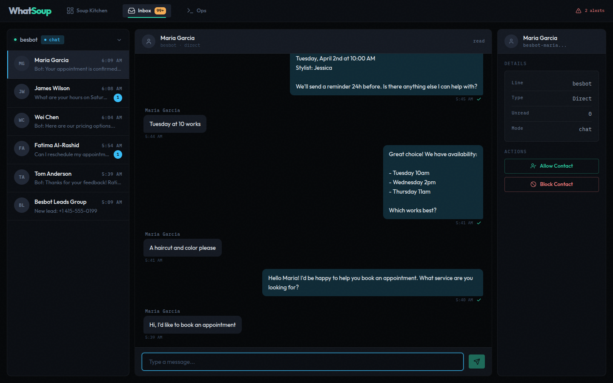

**Agent mode** — Shows autonomous agent sessions. The agent executes multi-step tasks (deployments, health checks, pipeline monitoring) and reports results back through the conversation.

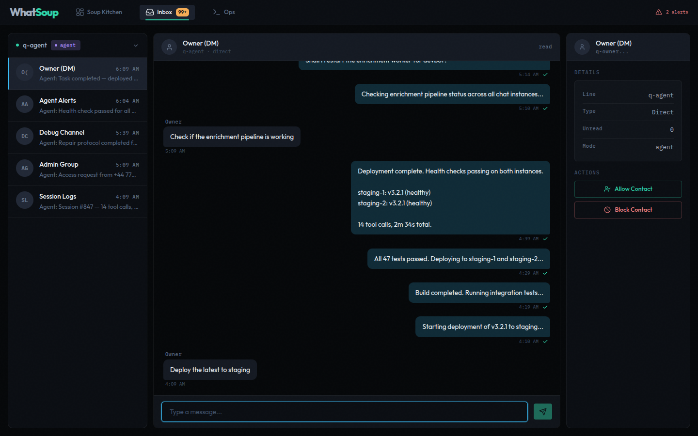

### Line Detail

Detailed view for a single instance. Accessed by clicking an instance name in the fleet overview or navigating to `/lines/:name`.

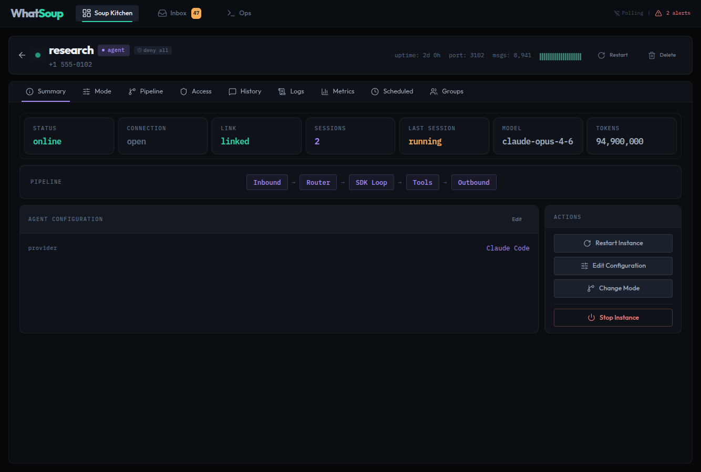

The header shows the instance name, mode badge, phone number, uptime, port, message count, and linked status. Action buttons for restart and delete are always accessible.

#### Tabs

**Summary** — Status, uptime, message count, mode, access mode, last activity. Pipeline stage badges show the message processing flow. Action buttons for restart, edit configuration, change mode, and stop/delete.

**Mode** — Shows the current runtime configuration as JSON.

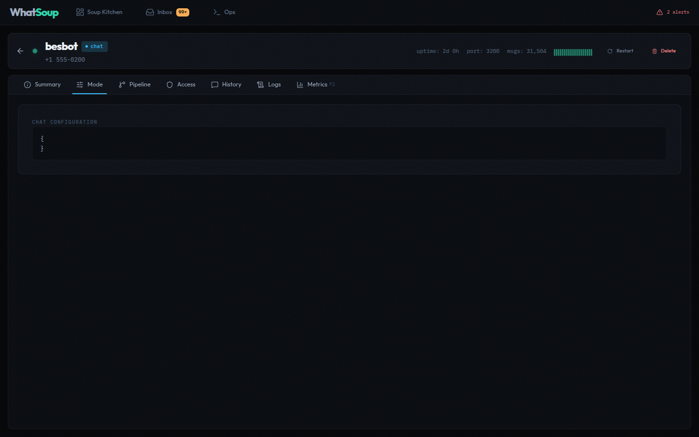

**Pipeline** — Visualizes the message processing stages: Inbound → Access → Queue → Match → Enrich → API → Outbound. Each stage is a clickable badge.

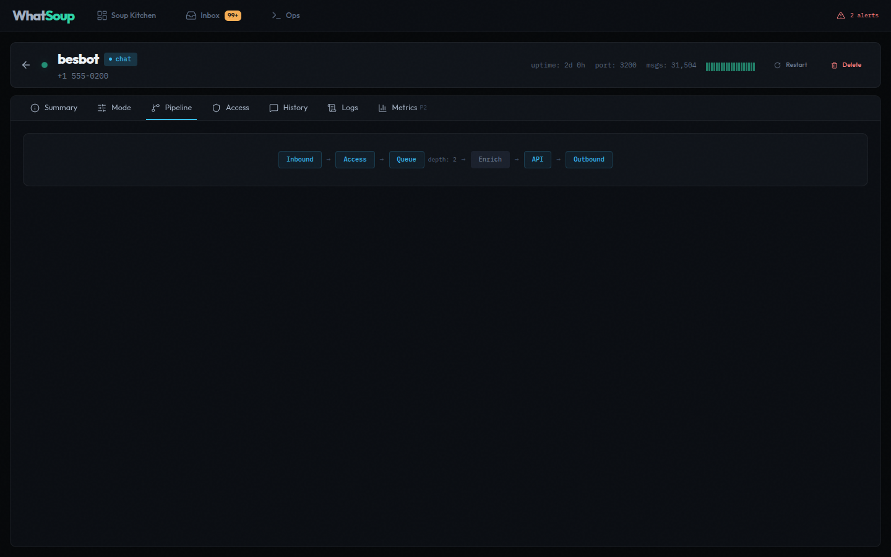

**Access** — Contact access control list. Shows pending requests, allowed contacts, and blocked contacts. Each entry shows the contact name, phone number, and status. Pending contacts have Allow/Block action buttons.

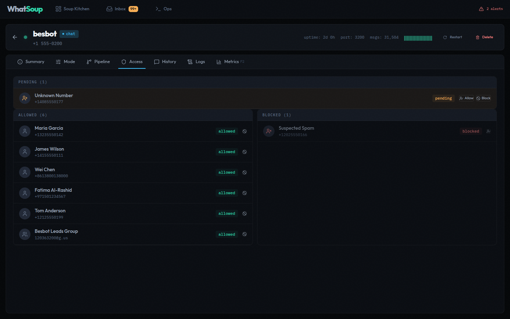

**History** — Chat conversations for this instance. Select a conversation on the left to view messages on the right.

**Logs** — Structured log viewer with level filtering (all, info, warn, error, debug). Shows timestamp, source, and message for each log entry.

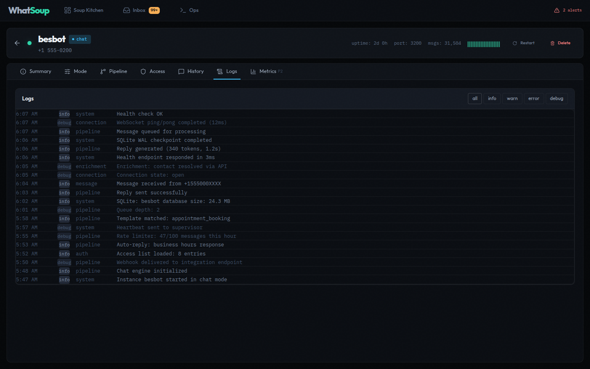

**Metrics** — Performance charts for this instance, scoped by a range selector (24h, 7d, 30d) and exportable as CSV.

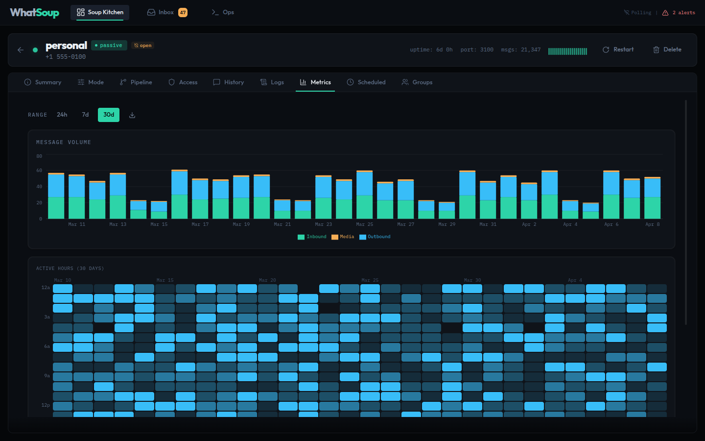

Four charts render when data is available:

- **Message Volume** — Bar chart of inbound, outbound, and media counts per time bucket.
- **Active Hours Heatmap** — Range-aware activity view: 24h renders a collapsed hourly bar chart, 7d renders a day-by-hour heatmap, and 30d renders a date-by-hour heatmap when daily data is available or a weekly pattern heatmap otherwise.
- **Tokens** — LLM input/output token usage over time, broken down by provider (toggle in the Tokens/Sessions tab strip).
- **Sessions** — Active and newly started agent sessions over time, broken down by provider.

Below the charts, the tab also shows static cards for cumulative **Token Usage** (input/output totals with a proportion bar) and **Model Configuration** (each configured model role returned for the line, such as conversation, extraction, validation, and fallback when present).

The CSV export button (top-right of the range selector) downloads Message Volume buckets as `<line>-<range>.csv` with `bucket`, `inbound`, and `outbound` columns. Media counts are charted but not included in the CSV export.

Empty, loading, and error states each render an `EmptyState` panel: a loading panel while the request is in flight, an error panel with a Retry action when the request fails, and a "No metrics data" panel when the instance has not yet processed any messages.

Data is fetched from `GET /api/lines/:name/metrics?range=24h|7d|30d` (per-line) with the fleet-wide aggregate available at `GET /api/metrics?range=24h|7d|30d` for the Fleet view.

**Scheduled** — Queue of scheduled messages for this instance. The header bar shows the total count and a "New Scheduled Message" button that opens the composer modal. Each row exposes Cancel, Edit, and Duplicate actions; pending and processing messages sort to the top by send time, with sent / failed / cancelled rows below in reverse chronological order. The list polls every 30 s. Empty, loading, and error states each render an `EmptyState` panel. This tab is only shown for instances with a global MCP socket (not sandbox-per-chat). Backed by `GET/POST/DELETE /api/lines/:name/scheduled` (list, create, cancel-all) and `GET/PUT/DELETE /api/lines/:name/scheduled/:id` (fetch, update, cancel one) — see the [Fleet API table](../README.md#fleet-api).

**Groups** — Groups this instance participates in. The header bar shows the total count and a "Create Group" button that opens the create modal. Each group card opens a detail modal with the participant list, promote / demote, add and remove participants, editable subject and description, invite link (get and revoke), ephemeral message duration, member-add mode (admins only vs all members), join-approval mode, pending join requests (approve / reject), and a Leave Group action. Successful detail mutations refresh both the detail and the group list immediately; the dialog heading uses the current detail. The list also polls every 30 s. This tab is only shown for instances with a global MCP socket (not sandbox-per-chat). Backed by 15 routes under `/api/lines/:name/groups/...` (list, create, get detail, leave, subject, description, participants, settings, invite get and revoke, ephemeral, member-add-mode, join-approval, requests get and update) — see the [Fleet API table](../README.md#fleet-api).

### Add Line Wizard

The `/hatch` onboarding journey creates a line before opening its link stream.
Leaving the page preserves that line and closes the owned stream; late responses
cannot open a new stream or advance the abandoned journey. A creation error is
unconfirmed until inspected in Lines, so Hatch offers that route and does not
automatically repeat creation. The link wait ends after six minutes with a visible
unconfirmed result. Check the line status before requesting a fresh code.

Only the current stream's confirmed connection advances to the ceremony. Going
back closes that stream; saving an unlinked line's persona returns to linking.
For a previously linked line, a successful persona save returns to the ceremony.
A rejected save keeps the editor and its input open. Pending creates and persona
saves admit one request and disable navigation that would discard their outcome.

The optional first message admits one attempt while the ceremony is open. A lost
response leaves the draft visible with an unconfirmed status and **Check Inbox**;
it does not automatically resend or announce success. Inspect that line's message
history before another send. Leaving the page does not cancel an accepted send,
and a late response cannot navigate or announce success on the abandoned page.
This is a per-page duplicate guard, not delivery deduplication across reloads or
other clients. At the fleet API, a failed socket response or HTTP server error returns
`message_send_unconfirmed` with `mutation_state: unknown` and `retryable: false`;
the existing HTTP status is retained. A thrown socket send has the same outcome
with status 500 and cannot fall through into a second HTTP send. HTTP routing remains available
when the socket is absent before any send attempt. A successful `dryRun` retains
its result without publishing message, chat or feed activity.

5-step provisioning flow for creating new instances. Accessed via the "Add Line" button on the fleet overview.

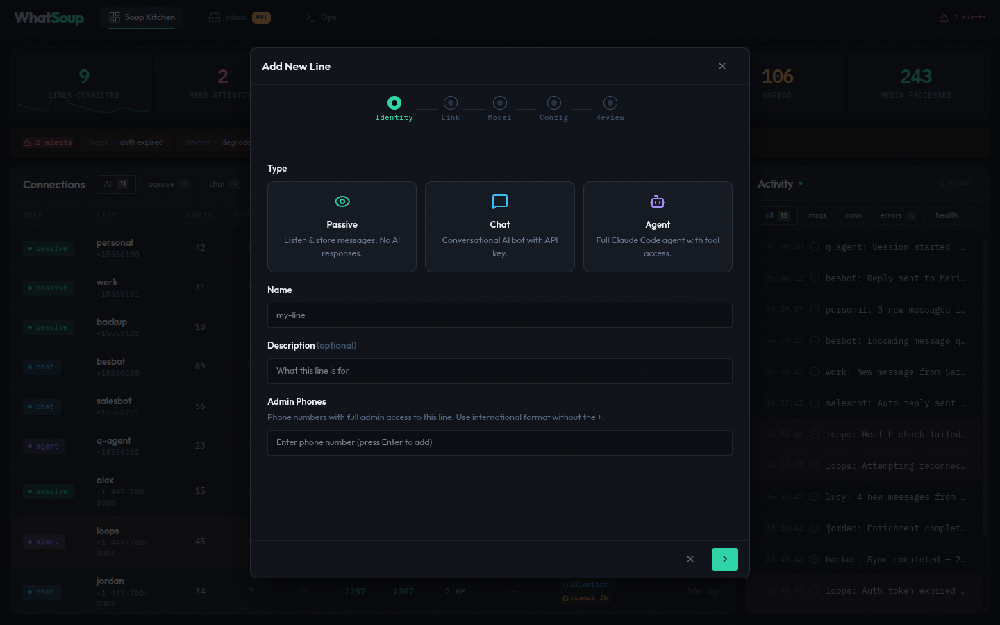

**Steps:**

1. **Identity** — Choose type (Passive, Chat, or Agent), set name, optional description, and admin phone numbers
2. **Link** — Scan QR code with WhatsApp to authenticate the instance
3. **Model** — Configure LLM models (conversation, extraction, validation) and API keys. Keys are stored in the OS keyring via the credentials API on finish — never written to config files. For Chat instances, **Custom OpenAI endpoint** and **Keyring Service** set `chatOptions.openaiProviderConfig` for OpenAI-compatible chat endpoints; the key value itself must be present on the host keyring or matching env var. Services outside the API write allowlist (e.g. `groq`, `openrouter`) are provisioned from the CLI instead; the wizard shows the exact command.
4. **Config** — Set access mode, rate limits, system prompt, and advanced settings. For Agent instances this step also selects the AI **Provider**; API-type providers (`openai-api`, `anthropic-api`) reveal **Base URL** and **Keyring Service** fields for custom (BYOK) endpoints — see [Custom endpoint](configuration.md#custom-endpoint-providerconfigbaseurl). Chat instance custom OpenAI endpoint fields remain editable later from the line configuration dialog.
5. **Review** — Confirm all settings before creating the instance

Type-matched accent colors distinguish the three modes throughout the wizard. Inline validation catches errors before submission.

## Design System

The console uses primitive, semantic and component tokens with dark and light
themes. Use the [design-system index](design-system/README.md) to find the current
requirements and the checks that enforce them; dated conformance reports do not
establish the state of a later revision.

Fonts are self-hosted: Hanken Grotesk for body text, IBM Plex Mono for data and
monospace text, and Bricolage Grotesque for display text. The definitions are in
[fonts.css](../console/src/styles/fonts.css) and
[tokens.primitive.css](../console/src/styles/tokens.primitive.css); provenance and
checksums are in the [font inventory](../console/public/fonts/README.md).

## Mock Mode

When the fleet server is unreachable, the console can fall back to built-in mock data. This is useful for:

- **Design iteration** — Work on the UI without running any WhatsApp instances
- **Demos** — Show the console to others without exposing real data
- **Development** — Test components with predictable, consistent data

**Activation rules (closes #420):**

- **Development builds** (`npm run dev`) — Mock mode activates automatically (1.5s timeout on fleet API check) and re-checks every 60 seconds.
- **Production builds** (`npm run build`) — Mock mode is **disabled by default**. Real fleet/auth failures surface as errors so the UI can render a true unhealthy state instead of masquerading as healthy mock data. To opt back in for demos or static showcase builds, set the Vite env var `VITE_MOCK_MODE=1` at build time (e.g. `VITE_MOCK_MODE=1 npm run build`).

When mock mode is active, supported read operations return deterministic mock data — line metadata, chats, messages, metrics, access lists, logs, feed/typing, scheduled messages, groups, and contact search. Other reads still require the live API, including `searchMessages`, `getScheduledById`, `checkExists`, `checkDirectory`, and `getVersion`. Consult [api.ts](../console/src/lib/api.ts) for each method's fallback behavior. Write operations always require a live fleet server.

## Development

```bash
cd console && npm run dev          # Vite dev server with hot reload + API proxy
cd console && npm run build        # Build to dist/, served by fleet server
cd console && npm run lint         # ESLint with token enforcement rules
```

The dev server proxies `/api/*` requests to the fleet server at `http://127.0.0.1:9099` with automatic Bearer token injection from `~/.config/whatsoup/fleet-tokens.json` (`active`). It falls back to the legacy `~/.config/whatsoup/fleet-token` file only when the rotatable token file is absent.
